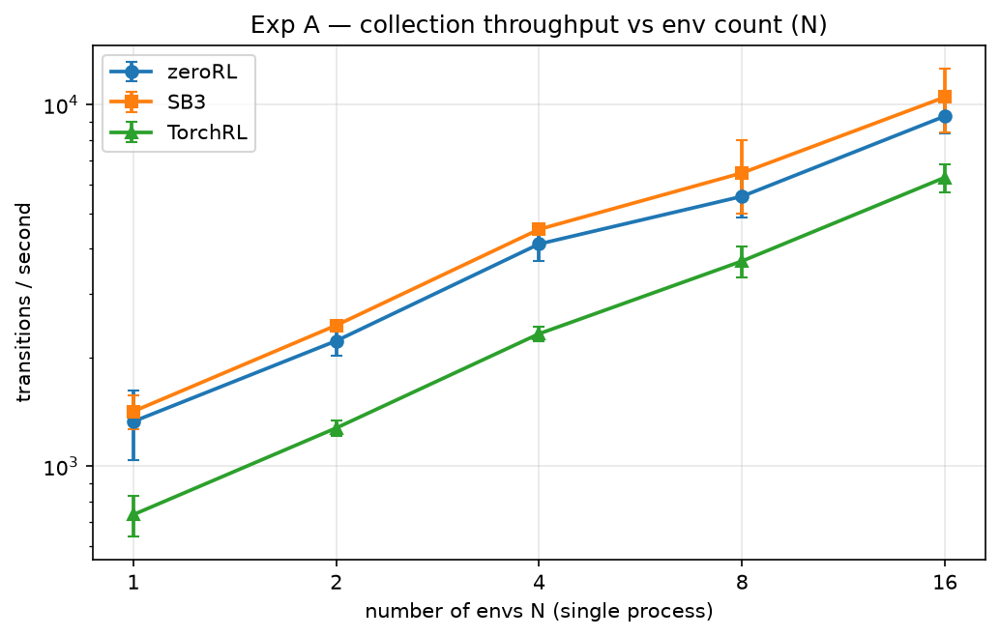
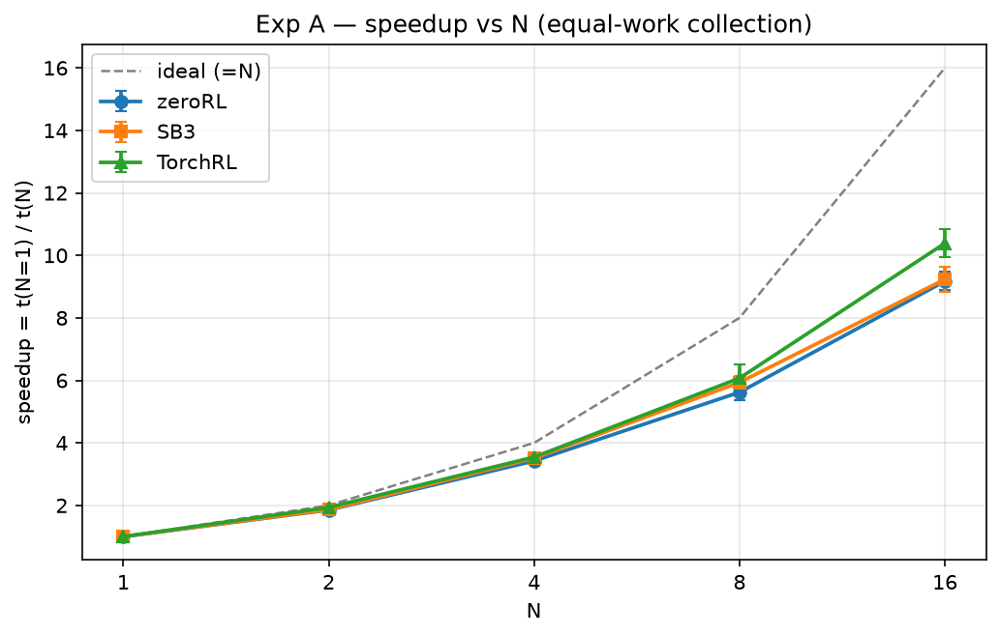
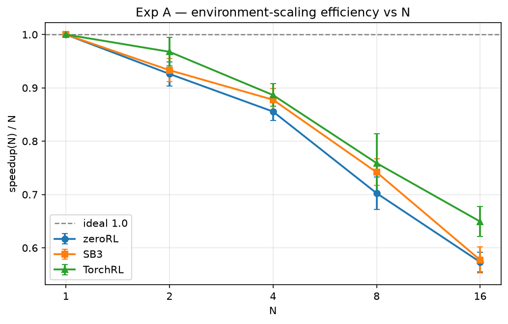
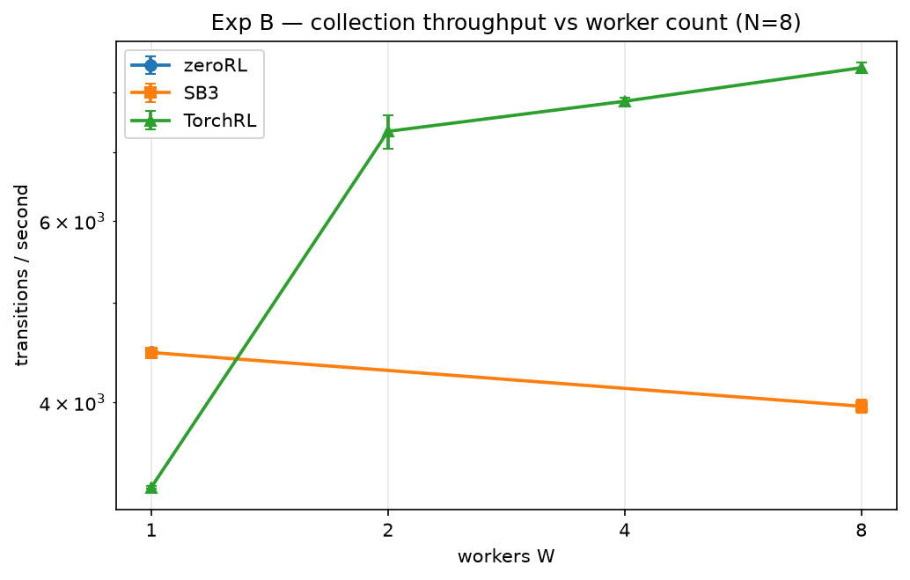
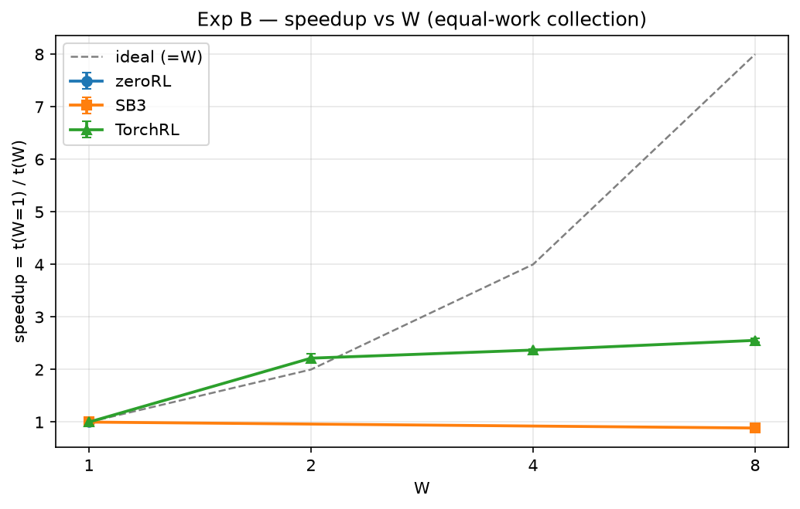
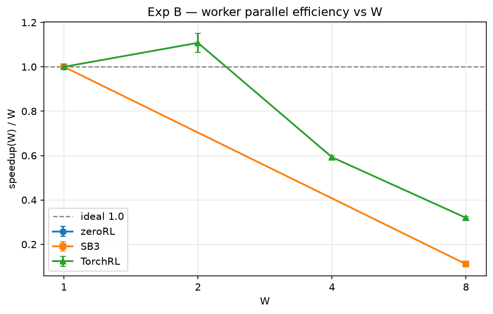
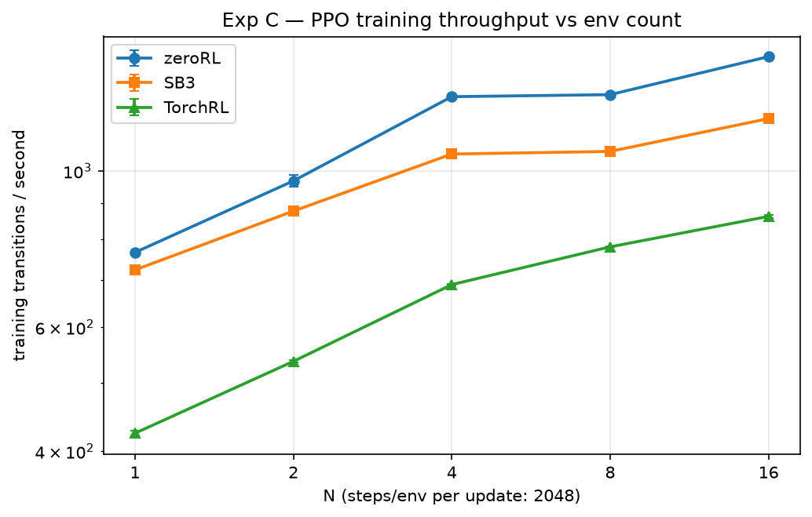
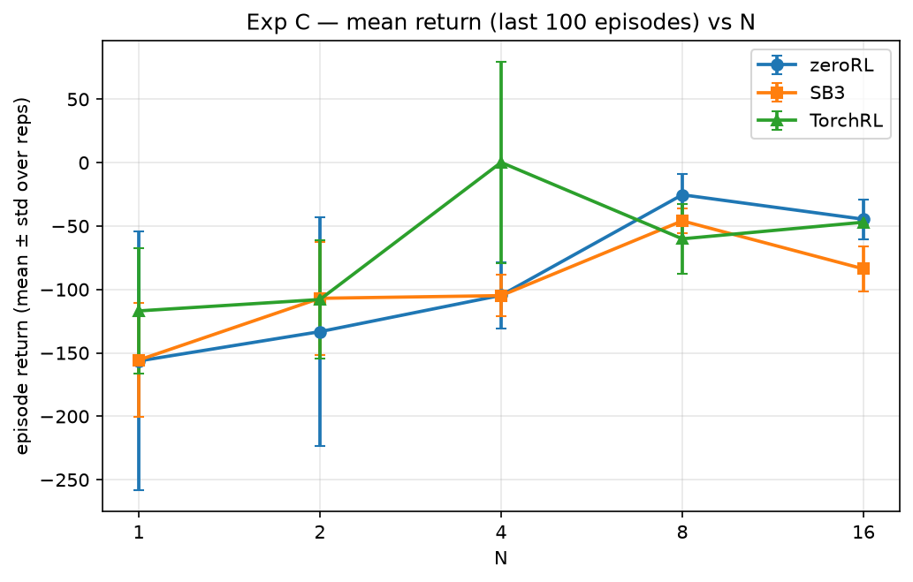
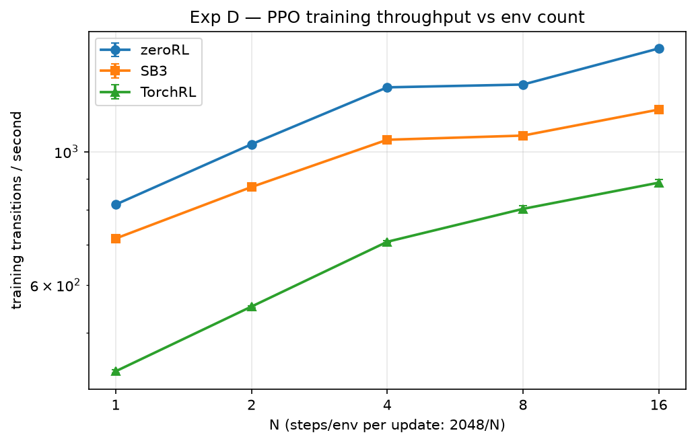
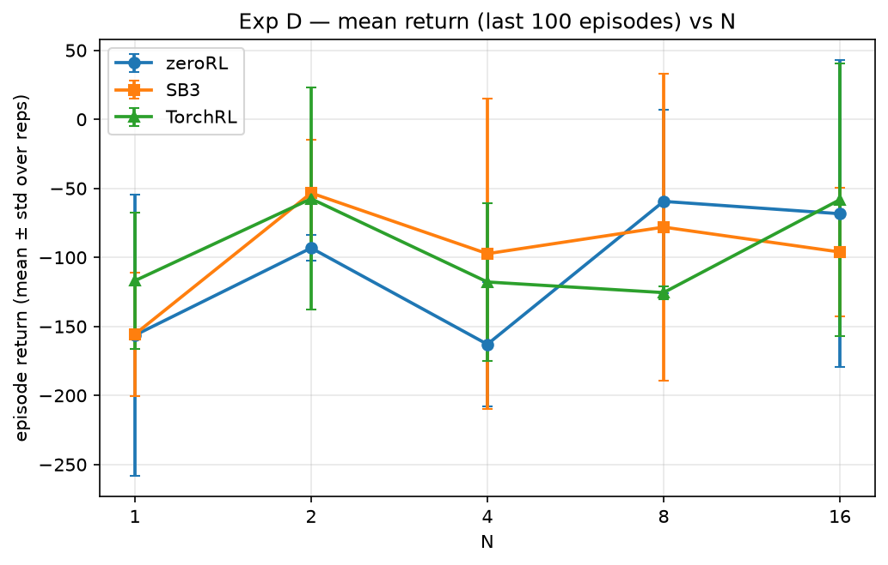

# Scalability benchmark report

Generated: 2026-11-03T23:13:55.289212+00:00 · rows: 517 · figures in `figures/`

## Environment

| key | value |
| --- | --- |
| python | 3.13.14 |
| platform | Linux-6.8.12-tegra-aarch64-with-glibc2.39 |
| processor | aarch64 |
| device | cpu |
| hostname | gpu1 |
| torch | 2.13.0+cu130 |
| torch_num_threads | 14 |
| cuda_available | True |
| gymnasium | 1.3.0 |
| sb3 | 2.9.0 |
| torchrl | 0.14.1 |
| tensordict | 0.14.3 |
| git_sha | 8eb6392d7b63993aa0108ea1a6d24946bc28df8f |

## Methodology (summary)

- Frameworks: zeroRL (this repo, official `rollout_phase` / `BaseTrain.train()`), Stable-Baselines3, TorchRL — same shared-trunk policy/weights where policies apply (see `policy_reference.py`).
- Experiments A/B count individual env transitions with a warmup of 16,000 (excluded) + 100,000 measured transitions per run; Experiments C/D train PPO for exactly 262,144 transitions per run.
- Repetitions: 5 seeds per cell for A/B, 3 for C/D; every reported statistic aggregates **all** ok repetitions (mean ± std), never best-of.
- Metrics: `throughput = measured / measure_seconds`, `speedup(N) = t(baseline) / t(N)`, `environment_scaling_efficiency(N) = speedup(N) / N`, `worker_parallel_efficiency(W) = speedup(W) / (W / 1)`.
- Phase timing: `init` = env + policy construction + weight load (+ TorchRL collector/worker spawn); `warmup` (A/B only, excluded); `boundary` (A/B only) = warmup→measure phase reset / collector-worker restart, timed as `boundary_seconds`; `measure` = the official training/collection steady state. Full framework-specific details in `INSPECTION.md`.
- Device: CPU (`CUDA_VISIBLE_DEVICES=""`); protocol C/D hyperparameters in `ppo_protocols.py` (lr 3e-4 linear-decay, gamma .99, gae_lambda .95, clip .2, entropy .01, value .5, epochs 10, batch 64, grad-clip .5).

## Experiment A — environment scaling (collection)

| framework | N | throughput (trans/s) | mean time (s) | speedup (paired) | env-scaling efficiency (paired) | pairs (n) |
| --- | --- | --- | --- | --- | --- | --- |
| zeroRL | 1 | 1,657.0 ± 15.6 | 60.35 | 1.00 | 1.00 | 5 |
| zeroRL | 2 | 2,415.7 ± 38.8 | 41.41 | 1.46 ± 0.02 | 0.73 ± 0.01 | 5 |
| zeroRL | 4 | 4,582.0 ± 47.1 | 21.83 | 2.75 ± 0.05 | 0.69 ± 0.01 | 5 |
| zeroRL | 8 | 4,755.4 ± 40.3 | 21.03 | 2.86 ± 0.03 | 0.36 ± 0.00 | 5 |
| zeroRL | 16 | 8,175.7 ± 127.6 | 12.23 | 4.93 ± 0.05 | 0.31 ± 0.00 | 5 |
| SB3 | 1 | 1,593.6 ± 10.5 | 62.75 | 1.00 | 1.00 | 5 |
| SB3 | 2 | 2,448.9 ± 18.0 | 40.84 | 1.54 ± 0.01 | 0.77 ± 0.01 | 5 |
| SB3 | 4 | 4,577.4 ± 62.5 | 21.85 | 2.85 ± 0.05 | 0.71 ± 0.01 | 5 |
| SB3 | 8 | 4,712.2 ± 29.3 | 21.22 | 2.96 ± 0.03 | 0.37 ± 0.00 | 5 |
| SB3 | 16 | 7,991.2 ± 124.6 | 12.52 | 5.02 ± 0.13 | 0.31 ± 0.01 | 5 |
| TorchRL | 1 | 826.2 ± 23.6 | 121.13 | 1.00 | 1.00 | 5 |
| TorchRL | 2 | 1,307.2 ± 73.6 | 76.72 | 1.53 ± 0.06 | 0.76 ± 0.03 | 5 |
| TorchRL | 4 | 2,382.4 ± 125.0 | 42.08 | 2.79 ± 0.10 | 0.70 ± 0.02 | 5 |
| TorchRL | 8 | 3,375.6 ± 98.6 | 29.65 | 4.05 ± 0.11 | 0.51 ± 0.01 | 5 |
| TorchRL | 16 | 5,785.2 ± 193.1 | 17.30 | 6.94 ± 0.36 | 0.43 ± 0.02 | 5 |

## Experiment A — GPU (device=cuda)

Rows recorded with device=cuda; every statistic in this section is computed on this side only and never combined with CPU rows.

| framework | N | throughput (trans/s) | mean time (s) | speedup (paired) | env-scaling efficiency (paired) | pairs (n) |
| --- | --- | --- | --- | --- | --- | --- |
| zeroRL | 1 | 1,084.8 ± 30.7 | 92.25 | 1.00 | 1.00 | 5 |
| zeroRL | 2 | 2,031.1 ± 37.8 | 49.25 | 1.85 ± 0.05 | 0.93 ± 0.02 | 5 |
| zeroRL | 4 | 3,752.1 ± 114.4 | 26.68 | 3.42 ± 0.07 | 0.86 ± 0.02 | 5 |
| zeroRL | 8 | 6,132.1 ± 209.2 | 16.33 | 5.62 ± 0.24 | 0.70 ± 0.03 | 5 |
| zeroRL | 16 | 10,055.8 ± 364.0 | 9.96 | 9.17 ± 0.29 | 0.57 ± 0.02 | 5 |
| SB3 | 1 | 1,301.8 ± 31.2 | 76.86 | 1.00 | 1.00 | 5 |
| SB3 | 2 | 2,458.5 ± 49.7 | 40.69 | 1.87 ± 0.04 | 0.93 ± 0.02 | 5 |
| SB3 | 4 | 4,491.4 ± 116.8 | 22.28 | 3.51 ± 0.08 | 0.88 ± 0.02 | 5 |
| SB3 | 8 | 7,658.3 ± 298.3 | 13.08 | 5.93 ± 0.20 | 0.74 ± 0.02 | 5 |
| SB3 | 16 | 12,179.2 ± 339.5 | 8.22 | 9.24 ± 0.39 | 0.58 ± 0.02 | 5 |
| TorchRL | 1 | 643.8 ± 15.5 | 155.42 | 1.00 | 1.00 | 5 |
| TorchRL | 2 | 1,245.6 ± 7.2 | 80.28 | 1.94 ± 0.05 | 0.97 ± 0.03 | 5 |
| TorchRL | 4 | 2,270.8 ± 56.6 | 44.06 | 3.55 ± 0.08 | 0.89 ± 0.02 | 5 |
| TorchRL | 8 | 4,015.5 ± 190.4 | 24.96 | 6.07 ± 0.44 | 0.76 ± 0.06 | 5 |
| TorchRL | 16 | 6,809.0 ± 204.9 | 14.70 | 10.39 ± 0.44 | 0.65 ± 0.03 | 5 |

## Experiment B — worker scaling (collection, N=8)

| framework | W | throughput (trans/s) | mean time (s) | speedup (paired) | worker parallel efficiency (paired) | pairs (n) |
| --- | --- | --- | --- | --- | --- | --- |
| zeroRL | 1 | 4,474.1 ± 20.8 | 22.35 | 1.00 | 1.00 | 5 |
| SB3 | 1 | 4,472.1 ± 38.7 | 22.36 | 1.00 | 1.00 | 5 |
| SB3 | 8 | 3,966.0 ± 59.4 | 25.22 | 0.89 ± 0.02 | 0.11 ± 0.00 | 5 |
| TorchRL | 1 | 3,308.5 ± 8.5 | 30.23 | 1.00 | 1.00 | 5 |
| TorchRL | 2 | 7,332.2 ± 273.1 | 13.65 | 2.22 ± 0.08 | 1.11 ± 0.04 | 5 |
| TorchRL | 4 | 7,842.2 ± 69.0 | 12.75 | 2.37 ± 0.02 | 0.59 ± 0.01 | 5 |
| TorchRL | 8 | 8,452.6 ± 104.3 | 11.83 | 2.55 ± 0.04 | 0.32 ± 0.00 | 5 |

**Unsupported (recorded, not run)**:

- zeroRL W=2: zeroRL has no multi-process environment path (vectorize_env -> SyncVectorEnv only); W>=2 unsupported
- zeroRL W=2: zeroRL has no multi-process environment path (vectorize_env -> SyncVectorEnv only); W>=2 unsupported
- zeroRL W=2: zeroRL has no multi-process environment path (vectorize_env -> SyncVectorEnv only); W>=2 unsupported
- zeroRL W=2: zeroRL has no multi-process environment path (vectorize_env -> SyncVectorEnv only); W>=2 unsupported
- zeroRL W=2: zeroRL has no multi-process environment path (vectorize_env -> SyncVectorEnv only); W>=2 unsupported
- zeroRL W=4: zeroRL has no multi-process environment path (vectorize_env -> SyncVectorEnv only); W>=2 unsupported
- zeroRL W=4: zeroRL has no multi-process environment path (vectorize_env -> SyncVectorEnv only); W>=2 unsupported
- zeroRL W=4: zeroRL has no multi-process environment path (vectorize_env -> SyncVectorEnv only); W>=2 unsupported
- zeroRL W=4: zeroRL has no multi-process environment path (vectorize_env -> SyncVectorEnv only); W>=2 unsupported
- zeroRL W=4: zeroRL has no multi-process environment path (vectorize_env -> SyncVectorEnv only); W>=2 unsupported
- zeroRL W=8: zeroRL has no multi-process environment path (vectorize_env -> SyncVectorEnv only); W>=2 unsupported
- zeroRL W=8: zeroRL has no multi-process environment path (vectorize_env -> SyncVectorEnv only); W>=2 unsupported
- zeroRL W=8: zeroRL has no multi-process environment path (vectorize_env -> SyncVectorEnv only); W>=2 unsupported
- zeroRL W=8: zeroRL has no multi-process environment path (vectorize_env -> SyncVectorEnv only); W>=2 unsupported
- zeroRL W=8: zeroRL has no multi-process environment path (vectorize_env -> SyncVectorEnv only); W>=2 unsupported
- SB3 W=2: SB3 SubprocVecEnv runs exactly one process per env, so only W=1 (DummyVecEnv) and W=8 (SubprocVecEnv) exist; W=2 unsupported
- SB3 W=2: SB3 SubprocVecEnv runs exactly one process per env, so only W=1 (DummyVecEnv) and W=8 (SubprocVecEnv) exist; W=2 unsupported
- SB3 W=2: SB3 SubprocVecEnv runs exactly one process per env, so only W=1 (DummyVecEnv) and W=8 (SubprocVecEnv) exist; W=2 unsupported
- SB3 W=2: SB3 SubprocVecEnv runs exactly one process per env, so only W=1 (DummyVecEnv) and W=8 (SubprocVecEnv) exist; W=2 unsupported
- SB3 W=2: SB3 SubprocVecEnv runs exactly one process per env, so only W=1 (DummyVecEnv) and W=8 (SubprocVecEnv) exist; W=2 unsupported
- SB3 W=4: SB3 SubprocVecEnv runs exactly one process per env, so only W=1 (DummyVecEnv) and W=8 (SubprocVecEnv) exist; W=4 unsupported
- SB3 W=4: SB3 SubprocVecEnv runs exactly one process per env, so only W=1 (DummyVecEnv) and W=8 (SubprocVecEnv) exist; W=4 unsupported
- SB3 W=4: SB3 SubprocVecEnv runs exactly one process per env, so only W=1 (DummyVecEnv) and W=8 (SubprocVecEnv) exist; W=4 unsupported
- SB3 W=4: SB3 SubprocVecEnv runs exactly one process per env, so only W=1 (DummyVecEnv) and W=8 (SubprocVecEnv) exist; W=4 unsupported
- SB3 W=4: SB3 SubprocVecEnv runs exactly one process per env, so only W=1 (DummyVecEnv) and W=8 (SubprocVecEnv) exist; W=4 unsupported

## Experiment C — PPO training protocol (fixed 2048 steps/env per rollout)

| framework | N | updates | throughput (trans/s) | mean time (s) | mean return (last 100) | reps |
| --- | --- | --- | --- | --- | --- | --- |
| zeroRL | 1 | 128 | 766.1 ± 4.5 | 342.2 | -156.4 ± 102.0 | 3 |
| zeroRL | 2 | 64 | 967.9 ± 18.2 | 270.9 | -133.3 ± 90.1 | 3 |
| zeroRL | 4 | 32 | 1,274.8 ± 8.4 | 205.6 | -104.6 ± 26.3 | 3 |
| zeroRL | 8 | 16 | 1,283.2 ± 5.5 | 204.3 | -25.3 ± 16.3 | 3 |
| zeroRL | 16 | 8 | 1,453.1 ± 5.5 | 180.4 | -44.6 ± 15.7 | 3 |
| SB3 | 1 | 128 | 723.5 ± 2.6 | 362.3 | -155.6 ± 44.8 | 3 |
| SB3 | 2 | 64 | 877.0 ± 0.8 | 298.9 | -107.0 ± 44.6 | 3 |
| SB3 | 4 | 32 | 1,056.8 ± 4.6 | 248.1 | -104.9 ± 16.5 | 3 |
| SB3 | 8 | 16 | 1,065.9 ± 3.0 | 245.9 | -45.9 ± 9.6 | 3 |
| SB3 | 16 | 8 | 1,186.6 ± 2.6 | 220.9 | -83.8 ± 17.8 | 3 |
| TorchRL | 1 | 128 | 424.2 ± 3.0 | 618.0 | -116.9 ± 49.3 | 3 |
| TorchRL | 2 | 64 | 536.6 ± 2.3 | 488.6 | -107.9 ± 46.7 | 3 |
| TorchRL | 4 | 32 | 689.6 ± 2.1 | 380.1 | 0.2 ± 79.1 | 3 |
| TorchRL | 8 | 16 | 780.2 ± 1.0 | 336.0 | -60.1 ± 27.6 | 3 |
| TorchRL | 16 | 8 | 861.9 ± 3.9 | 304.2 | -47.0 ± 2.1 | 3 |

## Experiment D — PPO training protocol (fixed global rollout of 2048)

| framework | N | updates | throughput (trans/s) | mean time (s) | mean return (last 100) | reps |
| --- | --- | --- | --- | --- | --- | --- |
| zeroRL | 1 | 128 | 816.5 ± 4.1 | 321.1 | -156.4 ± 102.0 | 3 |
| zeroRL | 2 | 128 | 1,028.6 ± 1.0 | 254.9 | -93.2 ± 9.3 | 3 |
| zeroRL | 4 | 128 | 1,279.2 ± 3.0 | 204.9 | -162.9 ± 44.9 | 3 |
| zeroRL | 8 | 128 | 1,293.0 ± 5.7 | 202.8 | -59.4 ± 66.5 | 3 |
| zeroRL | 16 | 128 | 1,484.7 ± 5.2 | 176.6 | -68.4 ± 111.2 | 3 |
| SB3 | 1 | 128 | 716.9 ± 1.9 | 365.7 | -155.6 ± 44.8 | 3 |
| SB3 | 2 | 128 | 873.2 ± 3.6 | 300.2 | -53.4 ± 38.9 | 3 |
| SB3 | 4 | 128 | 1,046.4 ± 2.1 | 250.5 | -97.3 ± 112.5 | 3 |
| SB3 | 8 | 128 | 1,063.3 ± 1.6 | 246.5 | -78.1 ± 111.2 | 3 |
| SB3 | 16 | 128 | 1,174.8 ± 5.8 | 223.1 | -96.1 ± 46.7 | 3 |
| TorchRL | 1 | 128 | 431.0 ± 3.0 | 608.2 | -116.9 ± 49.3 | 3 |
| TorchRL | 2 | 128 | 552.3 ± 2.1 | 474.7 | -57.5 ± 80.4 | 3 |
| TorchRL | 4 | 128 | 707.9 ± 2.7 | 370.3 | -117.8 ± 57.2 | 3 |
| TorchRL | 8 | 128 | 803.0 ± 9.3 | 326.5 | -125.5 ± 4.8 | 3 |
| TorchRL | 16 | 128 | 887.8 ± 11.4 | 295.3 | -58.2 ± 98.9 | 3 |

## Findings (computed from the data)

- Exp A collection, N=1: fastest = **zeroRL** (1,657 trans/s); also SB3 1,594, TorchRL 826.
- Exp A collection, N=2: fastest = **SB3** (2,449 trans/s); also zeroRL 2,416, TorchRL 1,307.
- Exp A collection, N=4: fastest = **zeroRL** (4,582 trans/s); also SB3 4,577, TorchRL 2,382.
- Exp A collection, N=8: fastest = **zeroRL** (4,755 trans/s); also SB3 4,712, TorchRL 3,376.
- Exp A collection, N=16: fastest = **zeroRL** (8,176 trans/s); also SB3 7,991, TorchRL 5,785.
- Exp B collection, W=1 (N=8): fastest = **zeroRL** (4,474 trans/s); also SB3 4,472, TorchRL 3,309.
- Exp B collection, W=2 (N=8): fastest = **TorchRL** (7,332 trans/s).
- Exp B collection, W=4 (N=8): fastest = **TorchRL** (7,842 trans/s).
- Exp B collection, W=8 (N=8): fastest = **TorchRL** (8,453 trans/s); also SB3 3,966.
- Exp C PPO, N=1: fastest = **zeroRL** (766 trans/s); also SB3 724, TorchRL 424.
- Exp C PPO, N=2: fastest = **zeroRL** (968 trans/s); also SB3 877, TorchRL 537.
- Exp C PPO, N=4: fastest = **zeroRL** (1,275 trans/s); also SB3 1,057, TorchRL 690.
- Exp C PPO, N=8: fastest = **zeroRL** (1,283 trans/s); also SB3 1,066, TorchRL 780.
- Exp C PPO, N=16: fastest = **zeroRL** (1,453 trans/s); also SB3 1,187, TorchRL 862.
- Exp D PPO, N=1: fastest = **zeroRL** (817 trans/s); also SB3 717, TorchRL 431.
- Exp D PPO, N=2: fastest = **zeroRL** (1,029 trans/s); also SB3 873, TorchRL 552.
- Exp D PPO, N=4: fastest = **zeroRL** (1,279 trans/s); also SB3 1,046, TorchRL 708.
- Exp D PPO, N=8: fastest = **zeroRL** (1,293 trans/s); also SB3 1,063, TorchRL 803.
- Exp D PPO, N=16: fastest = **zeroRL** (1,485 trans/s); also SB3 1,175, TorchRL 888.
- zeroRL env-scaling efficiency at N=16: 0.31 ± 0.00 (speedup 4.93 ± 0.05, n=5 paired reps, 16x envs).
- SB3 env-scaling efficiency at N=16: 0.31 ± 0.01 (speedup 5.02 ± 0.13, n=5 paired reps, 16x envs).
- TorchRL env-scaling efficiency at N=16: 0.43 ± 0.02 (speedup 6.94 ± 0.36, n=5 paired reps, 16x envs).
- zeroRL worker parallel efficiency at W=1: 1.00 (speedup 1.00, n=5 paired reps, 1x workers).
- SB3 worker parallel efficiency at W=8: 0.11 ± 0.00 (speedup 0.89 ± 0.02, n=5 paired reps, 8x workers).
- TorchRL worker parallel efficiency at W=8: 0.32 ± 0.00 (speedup 2.55 ± 0.04, n=5 paired reps, 8x workers).
- zeroRL N=1: training throughput C=766 vs D=817 trans/s (D faster).
- SB3 N=1: training throughput C=724 vs D=717 trans/s (≈ equal).
- TorchRL N=1: training throughput C=424 vs D=431 trans/s (D faster).

## Data integrity

| experiment | ok | failed | unsupported |
| --- | --- | --- | --- |
| A | 162 | 0 | 0 |
| B | 35 | 0 | 25 |
| C | 45 | 0 | 0 |
| D | 45 | 0 | 0 |

All ok rows recorded an exact transition budget.

GPU rows: 205 (device=cuda)

Total rows: 517.

## Appendix — protocol C/D configuration (from a result row)

| key | value |
| --- | --- |
| device | cpu |
| env_id | LunarLander-v3 |
| rollout_steps_per_env | 2048 |
| rollout_global | 2048 |
| updates | 128 |
| total | 262144 |
| lr | 0.0003 |
| gamma | 0.99 |
| gae_lambda | 0.95 |
| clip_eps | 0.2 |
| ent_coef | 0.01 |
| vf_coef | 0.5 |
| epochs | 10 |
| batch_size | 64 |
| grad_clip | 0.5 |
| lr_start | 0.0003 |
| lr_end | 0.0 |
| optimizer | {'type': 'Adam', 'eps': 1e-05, 'schedule': 'linear_decay_to_zero'} |
| net_arch | [64, 64] |
| reference_seed | 4242 |

---
See `README.md` (reproduction), `INSPECTION.md` (framework findings), `results/*.jsonl` (raw data).
